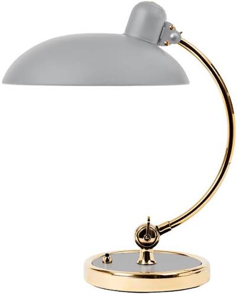
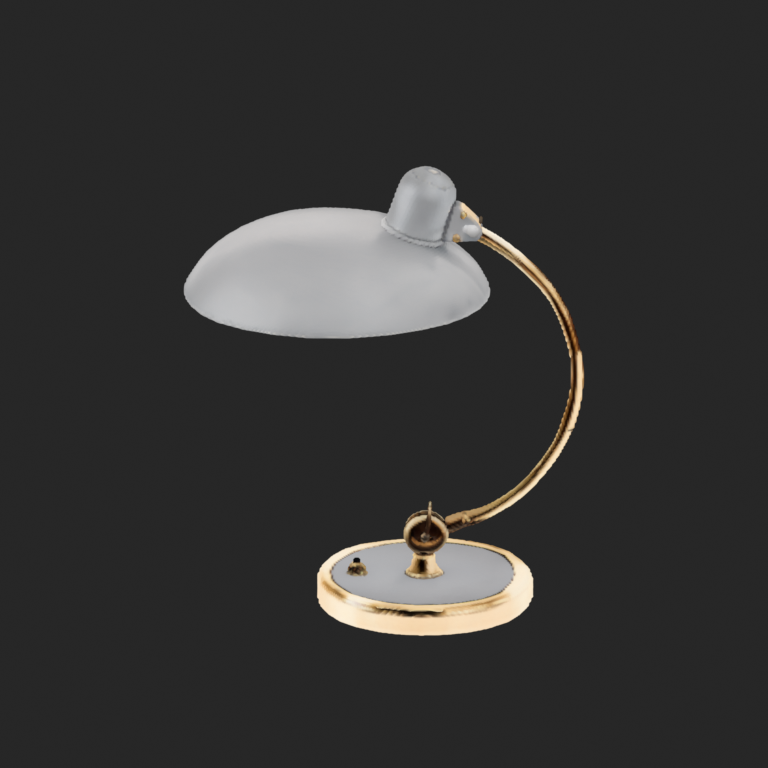

# Image to Blender · 白底商品图转可编辑网格

**借助 [Speridlabs IDOL](https://github.com/speridlabs/idol-sdk) 重建图片中的物体，再将其高斯表示转换成可在 [Blender](https://www.blender.org/) 编辑的三角网格和 `.blend` 文件。**

面向家具、灯具等单个商品图片的实验工作流。输入需要是**白底图，或已经抠好的透明 PNG**。保留可替换的抠图接口，方便后续接入其他分割工具。

This independent project uses **IDOL for image reconstruction** and **Blender for mesh editing and `.blend` export**. It does not train a new reconstruction model. It is not an official IDOL or Blender Foundation project. [@blender](https://github.com/blender) is credited as an upstream project, not an endorsement.

## 台灯实测

| 用户授权公开的输入 | 实际 IDOL 结果的网格预览 |
| --- | --- |
|  |  |

见 [台灯示例与下载](examples/lamp/README.md)、[真实测试环境和耗时](docs/BENCHMARKS.md)。示例来自真实 Spark 模型推理，没有手工重建替代模型结果；公开副本已清除隐私元数据。本仓库可复用已有网格改尺寸，不必重复模型推理。

**这是近似重建，不是尺寸准确的 CAD、干净拓扑或直接打印件。** 单图无法确认背面结构；薄杆、缝隙、平面、矩形角度、文字和金属表面可能出错。台灯保留原结果中的碎片和边界，没有为了展示而隐瞒或自动删掉。顶点颜色是烘焙外观，不是分解后的 PBR 材质。尺寸控制约束包围盒，不会自动修正剪切或恢复未知结构。

## 两种使用方式

1. **完整工作流（独立 Python）**：图片 → IDOL 原生 3DGS → 各向异性密度场 / Marching Cubes → 网格 → `.blend`。可在 Spark 上运行重建，在 Windows Blender 上导入／导出。
2. **Blender 插件（独立安装）**：导入本地网格包、调整整物体或选定部件的尺寸。使用 Blender 自带 Python，离线可用，不运行 IDOL，不安装 Torch，不下载模型。插件包不包含示例资产。

目前发布的是独立 GitHub 项目及插件 ZIP。**尚未获 Blender 官方扩展平台审核或收录。** [官方提交与许可边界](docs/LICENSING.md#blender-extensions-submission)说明了区别；不会向 Blender 主程序仓库提交整个模型运行环境。

## 安装 Blender 插件

从 [Releases](https://github.com/dadcolin/image-to-blender/releases) 下载 `idol_mesh_tools-0.1.0.zip`。Blender 4.2+ 中打开 Preferences → Add-ons → Install from Disk，选择 ZIP 并启用 **IDOL Mesh Tools**。实际烟雾测试版本记录在 [验证说明](docs/VALIDATION.md)。

- 3D View 的 **IDOL** 侧栏，或 File → Import → IDOL Derived Mesh。
- 选择完整网格包中的 `mesh-manifest.json`；它引用的 `mesh-data.json` 和 `source/` 要放在原相对位置。文件 SHA 不匹配会拒绝导入。
- Object Mode：约束当前活动网格整体尺寸。
- Edit Mode：手动选择灯罩／底座等部件顶点，再约束选中部分；其他顶点保留。这里没有自动语义分割，局部缩放可能拉伸连接处，需要检查。
- **Preserve proportions**：指定 X、Y 或 Z（高度），等比例缩放。
- **Fit X / Y / Z**：独立匹配三轴尺寸，可能改变比例。X/Y 是世界坐标轴，不自动猜测商品的“长/宽”。
- 单位支持 mm / cm / m；操作可 Undo。插件不会覆盖或自动保存当前文件，请另存 `.blend`。

已有修改器、形态键、共享 mesh data 或多物体 Edit Mode 会拒绝尺寸操作，避免把基础网格尺寸误当最终可见尺寸。

## 安装独立转换程序

Python 3.11+。建议专用虚拟环境，不要安装到 Blender 的 Python 环境：

```bash
git clone https://github.com/dadcolin/image-to-blender.git
cd image-to-blender
python -m venv .venv
# Linux: source .venv/bin/activate
# Windows PowerShell: .venv\Scripts\Activate.ps1
python -m pip install -e '.[test]'
```

只有图片推理需要 IDOL / Torch。先按 [IDOL 官方说明](https://github.com/speridlabs/idol-sdk)和设备平台安装兼容的 CUDA PyTorch，然后安装本项目检验的 SDK 修订：

```bash
python -m pip install 'idol @ git+https://github.com/speridlabs/idol-sdk.git@4702a7f00850e34b6e83a2170cc123c3e9570744'
```

独立依赖安装可能调整 PyTorch 版本，先查看安装计划；Spark/aarch64 需要对应平台可用的构建，不能照搬 x86 wheel。我们测试使用的软件版本在 benchmark 文档中。

模型从上游下载，不随仓库分发。DINOv3 / FLUX 依赖需要用户自己的有效访问授权，按上游要求通过本地 Hugging Face 登录工具配置。**不要把令牌写进命令行示例、issue 或仓库。** IDOL 本体固定 checkpoint 修订；依赖 encoder 由上游配置加载，首次运行可能下载。请阅读 [各组件许可](docs/LICENSING.md)，代码 GPL 不等于所有模型或图片都可无条件商用。

## 重建与导出

图片应只含一个完整物体，白底／透明，尽量保留细杆且不裁掉边缘；不包含商品页面文字、尺寸箭头、水印或其他物品。仅使用你有权处理的图片。

```bash
# GPU 机器：一次推理，产出 native/ 与 derived/mesh/ 两套带 SHA 的证据
python -B -m image_to_blender.cli reconstruct lamp.png --background white --output outputs/lamp-01

# 已抠图（必须有实际透明像素）；IDOL 会跳过 BiRefNet 的 mask 推理
python -B -m image_to_blender.cli reconstruct cutout.png --background alpha --output outputs/lamp-02

# 同机有 Blender 时，可一次完成导出；路径按你的安装位置修改
python -B -m image_to_blender.cli reconstruct lamp.png --output outputs/lamp-03 --blender blender
```

现有 IDOL SDK 在初始化时仍加载 BiRefNet，即使输入是 alpha；这里不宣称完全省掉其加载或内存。默认使用 eager / SDPA、50 步、262144 个高斯、seed 42、real 模式、crop margin 1.7；一次失败不会自动重试。

如果 GPU 在 Spark、Blender 在 Windows：把 `derived/mesh/` **整个目录**复制到 Windows，再从插件导入，或使用下面的 CLI。跨机器传输由操作者完成，仓库不含个人 SSH、服务器地址或服务停启逻辑。

```bash
# 复用已生成网格，等比例约束高度为 500 mm
python -B -m image_to_blender.cli export --mesh-manifest outputs/lamp-01/derived/mesh/mesh-manifest.json --blender blender --output outputs/lamp-height-500 --dimension-axis z --dimension-value 500 --unit mm --dimension-purpose user-specified

# 三轴外包尺寸（这是比例调整，不是自动结构纠错）
python -B -m image_to_blender.cli export --mesh-manifest outputs/lamp-01/derived/mesh/mesh-manifest.json --blender blender --output outputs/lamp-xyz --dimensions 300 250 500 --unit mm --dimension-purpose user-specified

# 只重新提取网格，不重复推理；可实验网格分辨率和密度阈值
python -B -m image_to_blender.cli mesh --source-manifest outputs/lamp-01/native/source-manifest.json --output outputs/lamp-new-mesh --resolution 256 --iso-level 0.5
```

输出目录必须不存在。导出后会启动新的 Blender 进程重新打开文件，验证顶点、面、颜色、Edit Mode 及实际包围盒；这属于技术验证，不代替视觉验收。保留原始高斯和网格清单可以独立核对来源。详见 [格式和几何说明](docs/WORKFLOW.md)。

## 可替换抠图接口

默认白底图使用 IDOL 自带 BiRefNet。准备一个自己信任的 Python 模块：

```python
# my_matting.py (place on your Python import path)
def remove_background(image):
    # Plug in your separately installed matting model here.
    # Return a PIL RGBA image with both transparent and visible pixels.
    raise NotImplementedError
```

然后明确传 `--matting-hook my_matting:remove_background`。钩子只在独立推理进程里执行，不进入 Blender 插件。它是可执行 Python 代码，只有你显式指定时才运行；程序不会搜索、下载或安装第三方抠图代码。

## 更多物体测试

台灯只是当前的一个案例，不足以证明所有家具都可还原。欢迎增加白底台灯、书架、椅子等。参照 [测试贡献说明](CONTRIBUTING.md) 和 `examples/case-template.json`：保留原图授权、输入 SHA、seed、设置、各阶段耗时、几何指标及多视角人工观察。失败案例也应保留；不能只发布漂亮结果。没有真实尺寸时不填写尺寸准确率。

## 开发与许可

```bash
python -B -m pytest -q
blender --command extension build --source-dir extension/idol_mesh_tools --output-dir dist
blender --command extension validate dist/idol_mesh_tools-0.1.0.zip
```

项目代码 [GPL-3.0-or-later](LICENSE)。IDOL、DINOv3、FLUX VAE、BiRefNet 和 Blender 的权利与贡献见 [THIRD_PARTY_NOTICES.md](THIRD_PARTY_NOTICES.md)。示例资产有独立声明，不自动按代码 GPL 或 CC0 发布。

本次发布凭据缺少 GitHub `workflow` 权限，自动 CI 尚未启用；[Actions 模板](docs/ci/README.md)已保留。本地验证及其边界见 [VALIDATION.md](docs/VALIDATION.md)。
