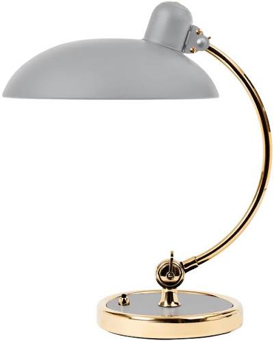
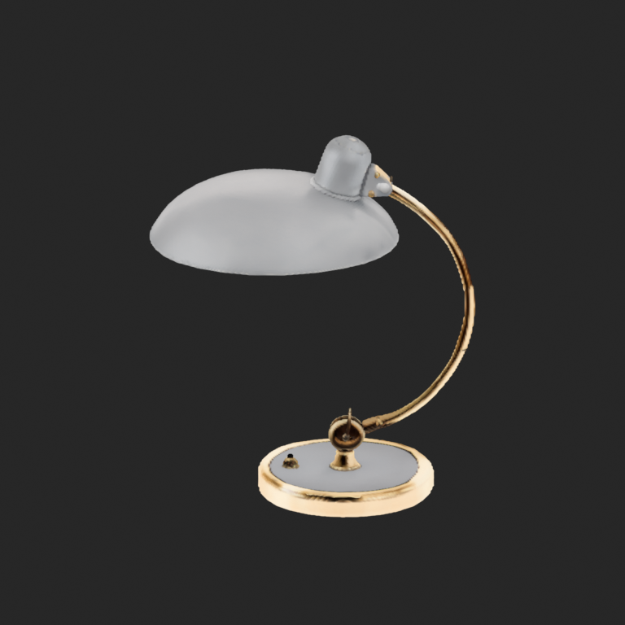

# Image to Blender

[English](README.md) | **简体中文**

**借助 [Speridlabs IDOL](https://github.com/speridlabs/idol-sdk) 重建图片中的物体，再将其高斯表示转换成可在 [Blender](https://www.blender.org/) 中编辑的三角网格和 `.blend` 文件。**

这是面向家具、灯具等单个商品图片的实验工作流。输入需要是**白底图，或已经抠好的透明 PNG**。通过显式指定、可替换的抠图接口，也可以接入其他背景移除工具。

本项目独立使用 **IDOL 完成图片重建**、使用 **Blender 完成网格编辑与 `.blend` 导出**，没有训练新的重建模型。它不是 Speridlabs IDOL 或 Blender Foundation 官方项目。对 [@blender](https://github.com/blender) 的引用表示上游致谢，不代表官方背书。

## 台灯实测

| 经贡献者授权公开的输入 | 实际 IDOL 结果的网格预览 |
| --- | --- |
|  |  |

见 [台灯示例与下载](examples/lamp/README.md)、[真实测试环境和耗时](docs/BENCHMARKS.md)。示例来自 DGX Spark 上的真实模型推理，没有用手工搭建的物体替代模型结果。公开副本已清除隐私元数据；已有网格可以直接修改尺寸，无需重复推理。

**这是近似重建，不是尺寸准确的 CAD、干净拓扑或可直接打印的零件。** 单张图片无法确定被遮挡的结构；细杆、缝隙、平面、矩形角度、文字和金属表面都可能出错。台灯示例保留原结果中的碎片和边界，没有为了展示而隐瞒。顶点颜色是烘焙外观，不是分解后的 PBR 材质。尺寸控制约束的是包围盒，不会自动修正剪切形变或恢复未知结构。

## 两种使用方式

1. **独立 Python 工作流**：图片 → IDOL 原生 3DGS → 各向异性密度场 / Marching Cubes → 网格 → `.blend`。可以在 Spark 上运行重建，在 Windows Blender 上导入、导出网格。
2. **独立安装的 Blender 插件**：导入本地网格包，调整整个物体或手动选中顶点的尺寸。插件使用 Blender 自带 Python，离线可用，不运行 IDOL、不安装 Torch、不下载模型。插件 ZIP 不包含示例资产。

目前通过独立 GitHub 项目及插件 ZIP 分发。**尚未获 Blender 官方扩展平台审核或收录。** 详见 [官方提交与许可边界](docs/LICENSING.md#blender-extensions-submission)。外部模型运行环境不属于拟向 Blender 主程序源码仓库提交的内容。

## 安装 Blender 插件

从 [Releases](https://github.com/dadcolin/image-to-blender/releases) 下载 `idol_mesh_tools-0.1.0.zip`。在 Blender 4.2+ 中打开 **Preferences → Add-ons → Install from Disk**，选择 ZIP 并启用 **IDOL Mesh Tools**。Blender 4.2 是声明的最低版本；实际测试版本见 [验证说明](docs/VALIDATION.md)。

- 打开 3D View 的 **IDOL** 侧栏，或 **File → Import → IDOL Derived Mesh**。
- 选择完整网格包中的 `mesh-manifest.json`；它引用的 `mesh-data.json` 和 `source/` 必须保留原相对位置。文件哈希不匹配时会拒绝导入。
- **Object Mode**：设置当前活动网格的整体尺寸。
- **Edit Mode**：手动选择灯罩、底座等部件的顶点，再约束选中部分的尺寸。未选中的顶点保持不变。这里没有自动语义分割；局部缩放可能拉伸连接处，需要检查。
- **Preserve proportions**：指定 X、Y 或 Z（高度），等比例缩放。
- **Fit X / Y / Z**：独立匹配三轴外包尺寸，可能改变比例。X、Y 指世界坐标轴，不会自动推断商品的“长”和“宽”。
- 单位支持 **mm / cm / m**，操作支持 Undo。插件不会覆盖或自动保存当前文件，请自行另存 `.blend`。

存在修改器、形态键、共享 mesh data，或处于多物体 Edit Mode 时，会拒绝尺寸操作，避免把基础网格尺寸误当成最终可见结果。

## 安装独立转换程序

需要 **Python 3.11+**。建议使用专用虚拟环境，与 Blender 的 Python 分开：

```bash
git clone https://github.com/dadcolin/image-to-blender.git
cd image-to-blender
python -m venv .venv
# Linux：source .venv/bin/activate
# Windows PowerShell：.venv\Scripts\Activate.ps1
python -m pip install -e '.[test]'
```

只有图片推理需要 IDOL 和 Torch。先按 [IDOL 官方说明](https://github.com/speridlabs/idol-sdk) 为设备平台安装兼容的 CUDA PyTorch，再安装本集成已检查的 SDK 修订：

```bash
python -m pip install 'idol @ git+https://github.com/speridlabs/idol-sdk.git@4702a7f00850e34b6e83a2170cc123c3e9570744'
```

依赖安装可能调整 PyTorch 版本，请先查看安装计划。Spark/aarch64 需要对应平台的构建，不能照搬 x86 wheel。参考测试所用版本记录在 [BENCHMARKS.md](docs/BENCHMARKS.md)。

模型权重需从上游获取，不随本仓库分发。DINOv3 和 FLUX 依赖需要用户自己的有效上游访问授权，请按上游要求使用本地 Hugging Face 登录工具配置。**不要把令牌写入命令示例、issue 或仓库。** IDOL 本体 checkpoint 修订已固定；encoder 依赖按上游配置加载，首次运行可能下载。请阅读 [组件许可说明](docs/LICENSING.md)：代码采用 GPL，并不代表所有模型或图片都可以无条件商用。

## 重建与导出

图片应只包含一个完整物体，使用白底或透明背景，尽量保留细杆和外缘。避免商品页面文字、尺寸箭头、水印和无关物体。仅处理你有权使用的图片。

```bash
# GPU 机器：一次推理，生成 native/ 和 derived/mesh/ 两套带哈希绑定的产物
python -B -m image_to_blender.cli reconstruct lamp.png --background white --output outputs/lamp-01

# 已抠图：必须有实际透明像素；跳过 IDOL 的 BiRefNet mask 推理
python -B -m image_to_blender.cli reconstruct cutout.png --background alpha --output outputs/lamp-02

# 同机有 Blender 时，可直接导出；按实际安装位置调整可执行文件路径
python -B -m image_to_blender.cli reconstruct lamp.png --output outputs/lamp-03 --blender blender
```

当前 IDOL SDK 在初始化时仍会加载 BiRefNet，即使输入是 alpha 图。跳过 mask 推理不等于省去模型加载或其内存开销。默认使用 eager / SDPA、50 步、262,144 个高斯、seed 42、real 模式及 crop margin 1.7。推理失败不会自动重试。

如果 GPU 在 Spark、Blender 在 Windows，请将 **`derived/mesh/` 整个目录**复制到 Windows，再从插件导入，或使用下面的 CLI。跨机器传输由操作者完成；本仓库不包含个人 SSH 配置、服务器地址或服务停启逻辑。

```bash
# 复用已生成的网格，等比例缩放至 500 mm 高度
python -B -m image_to_blender.cli export --mesh-manifest outputs/lamp-01/derived/mesh/mesh-manifest.json --blender blender --output outputs/lamp-height-500 --dimension-axis z --dimension-value 500 --unit mm --dimension-purpose user-specified

# 匹配三轴包围盒尺寸：这是比例调整，不是自动结构纠错
python -B -m image_to_blender.cli export --mesh-manifest outputs/lamp-01/derived/mesh/mesh-manifest.json --blender blender --output outputs/lamp-xyz --dimensions 300 250 500 --unit mm --dimension-purpose user-specified

# 重新提取网格，不重复推理；可实验网格分辨率和密度阈值
python -B -m image_to_blender.cli mesh --source-manifest outputs/lamp-01/native/source-manifest.json --output outputs/lamp-new-mesh --resolution 256 --iso-level 0.5
```

每个输出目录都必须尚不存在。导出后会启动新的 Blender 进程重新打开文件，验证顶点、面、颜色、Edit Mode 和实际包围盒尺寸。这些属于技术检查，不能代替视觉验收。保留原生高斯和产物清单，便于独立核对来源。详见 [工作流和几何说明](docs/WORKFLOW.md)。

## 可替换抠图接口

默认白底图使用 IDOL 自带 BiRefNet。要接入其他抠图工具，请提供自己信任的 Python 模块：

```python
# my_matting.py（放在 Python 可导入的路径中）
def remove_background(image):
    # 在这里接入单独安装的抠图模型。
    # 返回 PIL RGBA 图片，须同时包含透明像素和可见像素。
    raise NotImplementedError
```

在 `reconstruct` 命令中显式传入 `--matting-hook my_matting:remove_background`。钩子只在独立推理进程中执行，不进入 Blender 插件。它是可执行 Python 代码，仅在你明确指定时运行；程序不会自动发现、下载或安装第三方抠图代码。

## 更多物体测试

一个台灯案例不足以证明对所有家具或物体类别的还原能力。欢迎贡献白底台灯、书架、椅子等更多测试。参照 [CONTRIBUTING.md](CONTRIBUTING.md) 和 [案例模板](examples/case-template.json)，保留原图授权、输入 SHA、seed、设置、各阶段耗时、几何指标和多视角观察。失败案例也应保留，不能只发布漂亮结果。没有实物测量数据时，不报告尺寸准确率。

## 开发、状态与许可

```bash
python -B -m pytest -q
blender --command extension build --source-dir extension/idol_mesh_tools --output-dir dist
blender --command extension validate dist/idol_mesh_tools-0.1.0.zip
```

请查看 [GitHub Actions](https://github.com/dadcolin/image-to-blender/actions) 获取当前状态。[CI 配置说明](docs/ci/README.md) 介绍工作流设置；[VALIDATION.md](docs/VALIDATION.md) 记录本地验证及其边界。本 README 不宣称最新 CI 已通过。

项目代码采用 [GPL-3.0-or-later](LICENSE)。IDOL、DINOv3、FLUX VAE、BiRefNet 和 Blender 的致谢与许可边界见 [THIRD_PARTY_NOTICES.md](THIRD_PARTY_NOTICES.md) 和 [LICENSING.md](docs/LICENSING.md)。示例资产有独立的授权声明，不会自动按代码 GPL 或 CC0 分发。
