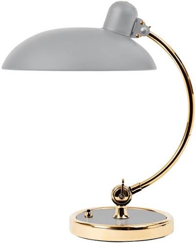
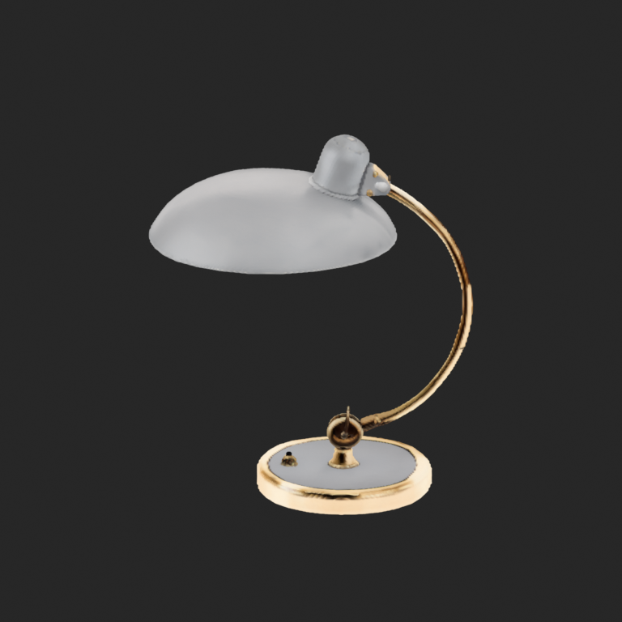

# Lamp: photograph to editable Blender mesh

This example was generated by the real IDOL workflow on NVIDIA DGX Spark. IDOL produced 262,144 Gaussian splats. A CPU postprocess sampled their anisotropic density and extracted a triangle mesh; it did not replace the object with a hand-built procedural lamp. The `.blend` contains an ordinary editable mesh and needs no Gaussian-splat add-on.

Open **[lamp-IDOL.blend](lamp-IDOL.blend)** in Blender. It was saved and reopened in Blender 5.2.3 LTS, including an Edit Mode check. The scene uses baked vertex color and an emission material to display the inferred appearance. Its camera is the predicted input camera; the preview image is an additional orbit view.

- [Input image](lamp-reference.png): metadata-free PNG with exactly the original decoded RGB pixels (401 × 498).
- [Preview](lamp-IDOL-preview.png): actual orbit render, not a generated reference illustration.
- [Twelve views](lamp-IDOL-views.png): input camera, eight orbit views, and front/side/top orthographic views.
- [Provenance](provenance.json): source hash, model revisions, parameters, output hashes, and geometry metrics.

The public scene is rebuilt from fresh Blender datablocks. Its mesh coordinates, topology, vertex colors, and object transform match the verified source arrays. Private paths, embedded notes, custom properties, and file-browser metadata are removed. The original local files were preserved. The images are re-encoded without metadata; decoded RGB pixels are unchanged.

## Parameters and limitations

Inference used `real` mode, crop margin 1.7, seed 42, 50 steps, guidance 3.0, time rescale 3.0, SDPA, and no compilation. The mesh uses a 256³ density grid, isovalue 0.5, minimum opacity 0.005, and 3-sigma support.

The result has **179,005 vertices and 354,288 triangular faces**. It retains **1,345 connected components**; the largest contains approximately 86.02% of vertices. There are four boundary edges and no zero-area faces or non-manifold edges under the recorded checks. Two strictly zero-area triangles were removed during numerical export; no smoothing, fragment removal, decimation, or lamp-specific shear correction was applied.

The shade edge and joints remain rough, and small screws/switch details are inaccurate. Back and occluded surfaces are inferred from a single photograph. The metallic reflections are baked colors, not a physically accurate material. No physical measurements were supplied: dimensions and roundness are unverified, and the mesh is not certified watertight, printable, or production-ready CAD. The sample preserves these defects so the workflow can be evaluated honestly.

## Demonstration permission

Redistribution of these example images and generated assets **for demonstration is granted by the contributor**. This statement grants no broader rights. Example assets are separate from the software license and are not part of the add-on package. Model weights are not included; their upstream access terms remain separate.
